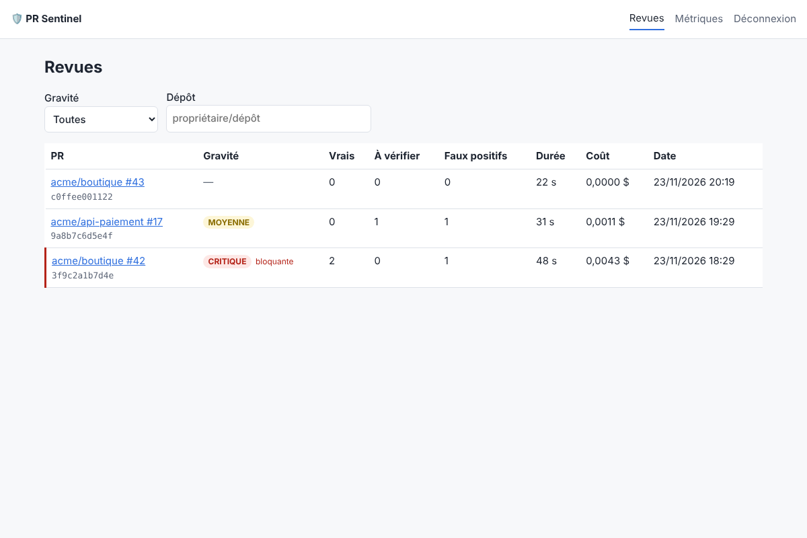
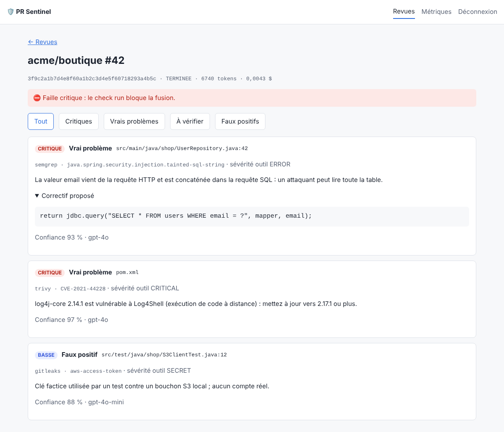
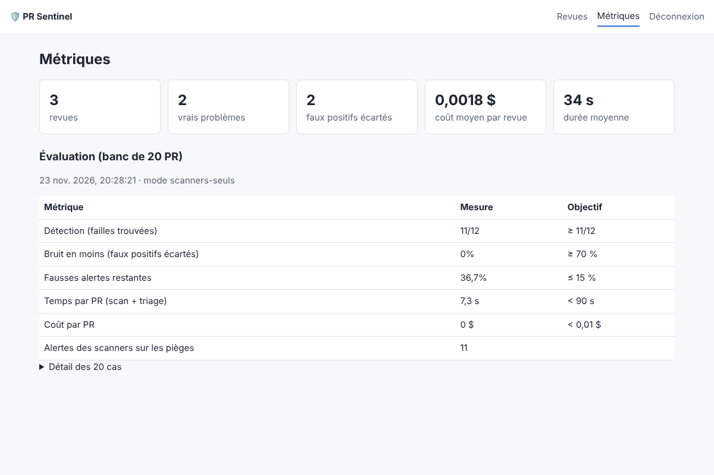

# PR Sentinel

Agent IA qui relit chaque pull request sous l'angle de la sécurité. Il lance **Semgrep**,
**Gitleaks** et **Trivy**, garde les alertes des lignes modifiées, puis un agent **Spring AI** trie les
vrais problèmes des fausses alertes, explique le risque en deux phrases et propose un correctif
applicable en un clic, directement dans la PR. Un *check run* bloque la fusion tant qu'une faille
critique reste ouverte.

Java 21 · Spring Boot 3.5 · Spring AI 1.1 · PostgreSQL (Flyway) · Angular 22 · GitHub App

```
GitHub ──webhook signé──▶ Spring Boot /webhooks/github ──▶ PostgreSQL (scan_job, SKIP LOCKED)
                                                              │
   revue + suggestions ◀── GitHub App ◀── worker ── clone du commit ── Semgrep · Gitleaks · Trivy
   check run                                │                              │
                                            │        filtre : lignes modifiées par la PR
                                            ▼                              │
                         PostgreSQL ◀── verdicts JSON ◀── agent IA (lireFichier · lireDiff · chercher)
                              │
                              ▼
                     tableau de bord Angular
```

## Ce que fait une revue

1. **Réception** : signature `X-Hub-Signature-256` vérifiée à temps constant, tâche enregistrée en base,
   réponse en quelques millisecondes. Une livraison rejouée ne crée pas de doublon ; un nouveau push
   remplace la tâche en attente.
2. **Scan** : clone superficiel du commit exact (jeton hors argv et hors URL, ni hooks, ni liens
   symboliques, ni sous-modules), puis les trois scanners avec délai maximal. Les fichiers par lesquels
   une PR pourrait désactiver un scanner (`.gitleaksignore`, `.semgrepignore`, `trivy.yaml`…) sont
   supprimés avant l'analyse, et les commentaires `nosemgrep` / `gitleaks:allow` sont ignorés.
3. **Filtrage** : seules les alertes sur les lignes ajoutées par la PR (API `pulls/{n}/files`) sont
   gardées, plus les dépendances vulnérables des fichiers modifiés.
4. **Triage IA** : pour chaque alerte (30 au plus, les plus graves d'abord), l'agent lit le contexte,
   appelle au plus 5 outils et rend un verdict structuré :
   ```java
   record Verdict(Decision decision,   // VRAI_PROBLEME, FAUX_POSITIF, A_VERIFIER
                  Gravite gravite,     // CRITIQUE, HAUTE, MOYENNE, BASSE
                  String explication,  // 2 phrases max
                  String correctif,    // remplacement proposé, ou null
                  double confiance) {}
   ```
   Une réponse hors format est rejetée et relancée une fois. `gpt-4o-mini` par défaut ; second avis de
   `gpt-4o` quand une alerte est jugée critique.
5. **Publication** : revue GitHub avec résumé, commentaires sur les lignes et blocs `suggestion` ; les
   faux positifs écartés restent consultables dans un bloc replié. Sans clé OpenAI, ou une fois le budget
   du jour atteint, PR Sentinel publie les alertes brutes.

| Revues | Détail d'une PR | Métriques |
|---|---|---|
|  |  |  |

<sub>Captures prises sur des données de démonstration fictives.</sub>

## Sécurité de l'outil lui-même

- **Accès GitHub** : HMAC du webhook vérifié à chaque requête ; jeton d'installation limité au seul
  dépôt de la PR et aux permissions `contents: read`, `pull_requests: write`, `checks: write`,
  `metadata: read` ; clé privée uniquement en variable d'environnement.
- **Connexion GitHub** : état OAuth aléatoire lié au navigateur par un cookie `HttpOnly` (contre la
  connexion forcée) ; le jeton GitHub de l'utilisateur ne sert que pendant la connexion et n'est jamais
  stocké ; le front reçoit un code à usage unique (2 min) dans le fragment d'URL, échangé contre un jeton
  de session de 8 h ; codes et sessions ne sont stockés que sous forme d'empreinte SHA-256 ; redirections
  vers la seule URL de front configurée ; déconnexion révoquée côté serveur. Les données sont filtrées par
  dépôt dans chaque requête SQL (une revue d'un autre dépôt répond 404).
- **Facturation** : webhooks Stripe vérifiés (HMAC-SHA256 sur le corps brut, horodatage à 5 min) ; l'état
  de l'abonnement est toujours relu dans l'API Stripe plutôt que pris dans l'événement (idempotent,
  insensible à l'ordre) ; un utilisateur ne peut payer ou gérer que les comptes GitHub auxquels il a accès ;
  aucune donnée de carte ne transite par PR Sentinel (Checkout et portail hébergés par Stripe).
- **Code analysé = donnée non fiable** : jamais exécuté ; le prompt place le code entre délimiteurs que
  le contenu ne peut pas imiter et précise qu'il s'agit de données, ce qui neutralise les « ignore les
  alertes » glissés dans un commentaire (cas `20-prompt-injection` du banc). Les secrets sont masqués
  avant tout envoi au modèle ; seule leur empreinte SHA-256 est stockée.
- **Exécution** : scanners sans shell, environnement filtré, arbre de processus tué au délai maximal,
  rapports plafonnés ; base Trivy intégrée à l'image (aucun téléchargement pendant l'analyse) ;
  dossier de travail supprimé après chaque revue ; conteneurs en lecture seule, sans capacités.
- **Verdicts fermés par défaut** : le petit modèle ne peut pas écarter seul une alerte grave (CRITICAL,
  HIGH, ERROR, SECRET) ; un FAUX_POSITIF doit être confirmé par le modèle fort. Le check run échoue tant
  qu'une alerte grave reste non triée ou « à vérifier », ou qu'un scanner a échoué : saturer le plafond
  ou le budget ne fait pas passer une PR.
- **Agent borné** : la boucle d'outils est pilotée par PR Sentinel (tours plafonnés, chaque appel compté),
  le triage a une échéance, les fichiers sensibles (`.env`, clés, `.git`) ne sont jamais lus, les
  chemins sont résolus sans suivre les liens symboliques.
- **Suggestions prudentes** : un correctif n'est publié en bloc `suggestion` que s'il est court et
  n'introduit ni URL, ni exécution de commande, ni import, ni secret ; il est signalé comme généré par l'IA.
- **Publication idempotente** : une revue déjà publiée pour un commit n'est jamais republiée ; un worker
  dont le bail a été repris ne publie rien.
- **Coûts et abus** : plafond de dépense par jour et par dépôt (coût compté même en cas d'échec),
  30 alertes au plus envoyées au modèle.
- **Tableau de bord** : jeton Bearer (32 caractères minimum) comparé à temps constant, CORS limité,
  CSP stricte côté front ; l'API `/api` est désactivée sans jeton.
- **Pipeline** : tests JUnit + Testcontainers, SonarCloud (si configuré), image Docker signée avec
  cosign, Dependabot.

## Évaluation

Le banc `eval/cases` contient 20 PR dont on connaît la bonne réponse : 12 vraies failles (injection
SQL, XSS, commande shell, path traversal, SSRF, désérialisation, JWT sans signature, CSRF désactivé,
redirection ouverte, MD5 pour les mots de passe, secret commité, log4j 2.14.1) et 8 pièges que les
scanners signalent alors que le code est sûr (fausse clé de test, SQL/commande/redirection sur liste
blanche, MD5 de cache, `Random` d'affichage, CSRF d'une API sans état, commentaire d'injection de prompt).

```bash
cd backend && mvn -q compile exec:java -Dexec.args="--cases ../eval/cases --out ../eval/report.json"
```

Le workflow `eval.yml` relance le banc à chaque modification du prompt, de l'agent ou des cas, et
échoue si la détection descend sous 11/12 : le prompt est testé comme du code.

**Mesuré avec l'agent** (`eval/report.json`, 24/11/2026, 4e passage) : gpt-4o-mini, confirmation des
vrais problèmes par gpt-4o (hors dépendances), règles Semgrep du registre (`p/java`, `p/typescript`,
`p/owasp-top-ten`) plus deux règles ciblées (désérialisation, CSRF désactivé), Gitleaks 8.30, Trivy 0.76.

| Métrique | 1er passage | 2e | 3e | 4e passage | Objectif |
|---|---|---|---|---|---|
| Failles confirmées | 10/12 | 11/12 | 11/12 | **12/12** | ≥ 11/12 |
| Fausses alertes écartées (bruit en moins) | 50 % | 77,8 % | 100 % | **100 %** (9 sur 9) | ≥ 70 % |
| Fausses alertes parmi les alertes publiées | 18,2 % | 9,5 % | 0 % | **0 %** | ≤ 15 % |
| Temps par PR (scan + triage) | 11,4 s | 12,5 s | 10,9 s | **11,8 s** | < 90 s |
| Coût par PR | 0,0064 $ | 0,0115 $ | 0,0073 $ | **0,0074 $** | < 0,01 $ |

À lire avec prudence : le prompt a été ajusté au fil des passages en regardant les erreurs sur ce même
banc (MD5 de cache, CSRF sans état, listes blanches). Ces chiffres mesurent donc un banc vu pendant la
mise au point, sur un seul passage d'un modèle non déterministe. Pour une mesure de généralisation, il
faut des cas tenus à l'écart (non vus) et plusieurs passages.

**Mesuré sur 10 cas tenus à l'écart** (`eval/holdout`, figés avant tout passage de l'agent, jamais
utilisés pour régler le prompt ; 3 passages, `eval/report-holdout-{1,2,3}.json`) :

| Métrique | Passage 1 | Passage 2 | Passage 3 | Objectif |
|---|---|---|---|---|
| Failles confirmées | 6/6 | 6/6 | 6/6 | ≥ 92 % |
| Fausses alertes écartées | 66,7 % (4 sur 6) | 66,7 % | 66,7 % | ≥ 70 % |
| Fausses alertes parmi les alertes publiées | 20 % | 20 % | 20 % | ≤ 15 % |
| Temps par PR (scan + triage) | 10,6 s | 11,1 s | 11,0 s | < 90 s |
| Coût par PR | 0,0076 $ | 0,0083 $ | 0,0084 $ | < 0,01 $ |

Résultats identiques sur les 3 passages. Toutes les failles nouvelles (JPA, XXE, Zip Slip, TLS, Slack,
Text4Shell) sont confirmées ; 3 pièges sur 4 sont écartés. Le piège manqué est une requête qui
concatène le nom d'une énumération (`Status.valueOf(...)` rejette toute autre valeur) : gpt-4o la juge
CRITIQUE à chaque passage. Sur des cas jamais vus, le bruit en moins et les fausses alertes restantes
sont donc **juste sous les objectifs**, contrairement au 12/12 du banc de mise au point.

Référence sans agent (`eval/report-scanners-seuls.json`, règles Java locales de `semgrep-rules`) :
12/12 failles signalées, 11 fausses alertes sur les 8 pièges, 35,5 % de fausses alertes publiées.

## Limites connues

- Les scanners tournent sous le même utilisateur que le worker : une faille d'un scanner exploitée par
  un dépôt piégé pourrait lire ses secrets. Prochaine étape : un bac à sable par scan (uid séparé, sans
  réseau ni secret).
- Pas de limite par auteur de PR : sur un dépôt public, n'importe qui peut consommer le budget du jour
  (la PR est alors bloquée, pas acceptée).
- Les actions GitHub sont épinglées par version, pas par empreinte ; les règles Semgrep du registre ne
  sont pas figées.
- Sur 10 cas tenus à l'écart : 6/6 failles, mais 66,7 % de bruit en moins et 20 % de fausses alertes
  restantes (objectifs 70 % et 15 %) ; une concaténation sûre d'un nom d'énumération est jugée critique.

## Installation

1. **GitHub App** : permissions *Contents* (lecture), *Pull requests* (écriture), *Checks* (écriture),
   *Metadata* (lecture) ; événement *Pull request* ; URL de webhook `https://<api>/webhooks/github` ;
   secret de webhook (`openssl rand -hex 32`). Télécharger la clé privée.
2. **Local** :
   ```bash
   cp .env.example .env
   ```
   ```bash
   docker compose up --build
   ```
3. **Railway** (API, worker et PostgreSQL) : `railway.json` construit `docker/Dockerfile` ; deux services
   depuis la même image (`SENTINEL_WORKER_ENABLED=false` pour l'API, `true` pour le worker), variables
   de `.env.example`.
4. **Vercel** (front) : répertoire `frontend/`, `vercel.json` fourni ; définir
   `SENTINEL_DASHBOARD_ALLOWED_ORIGINS` côté API avec l'URL Vercel. L'API doit être servie en HTTPS (CSP).
5. **Connexion GitHub** (comptes utilisateurs) : dans la GitHub App, onglet « General », générer un
   *client secret* et déclarer l'URL de rappel `<URL de l'API>/auth/github/callback` ; côté API, définir
   `SENTINEL_GITHUB_CLIENT_ID`, `SENTINEL_GITHUB_CLIENT_SECRET`, `SENTINEL_PUBLIC_URL` (URL de l'API) et
   `SENTINEL_FRONT_URL` (URL du front). Chaque utilisateur ne voit que les dépôts où l'app est installée et
   auxquels il a accès sur GitHub (relevés à chaque connexion). Le jeton `SENTINEL_DASHBOARD_TOKEN` reste
   l'accès opérateur (tous les dépôts).
6. **Facturation Stripe** (offre Découverte gratuite limitée à 50 revues par mois et par compte GitHub,
   offre Équipe au siège avec 14 jours d'essai) :
   - dans Stripe, créer un produit « PR Sentinel Équipe » avec un prix récurrent mensuel par unité
     (`price_...`), activer le portail client, et créer un webhook vers `<URL de l'API>/stripe/webhook`
     (événements `checkout.session.completed` et `customer.subscription.*`) ;
   - API : `SENTINEL_STRIPE_SECRET_KEY` (clé restreinte conseillée : Checkout Sessions, Customer portal,
     Subscriptions en écriture/lecture), `SENTINEL_STRIPE_WEBHOOK_SECRET`, `SENTINEL_STRIPE_PRICE_EQUIPE` ;
   - worker : `SENTINEL_BILLING_QUOTAS=true` et `SENTINEL_FRONT_URL` (lien du check run). Au-delà du quota,
     la PR n'est pas analysée et reçoit un check run « neutral » qui le dit explicitement.
   Sans ces variables, aucune limite ne s'applique (auto-hébergement).
7. **Banc réel** : `eval/push-bench.sh <clone du dépôt de banc>` ouvre les 20 cas en vraies PR sur un
   dépôt où l'app est installée.

## Développement

```bash
cd backend && mvn verify
```
```bash
cd frontend && npm ci && npx ng test --watch=false && npx ng build
```

Les tests d'intégration utilisent Testcontainers ; sans Docker, définir
`TEST_DATABASE_URL=jdbc:postgresql://localhost:5432/<base>`.

```
backend/   Spring Boot : webhook/, scan/, diff/, agent/, github/, review/ (+ api/ du tableau de bord), eval/
frontend/  Angular : revues, détail d'une PR, métriques
eval/      20 cas, script de publication en vraies PR
docker/    Dockerfile (JDK 21 + Semgrep + Gitleaks + Trivy, base intégrée)
.github/   ci.yml, eval.yml, release.yml, dependabot.yml
```
